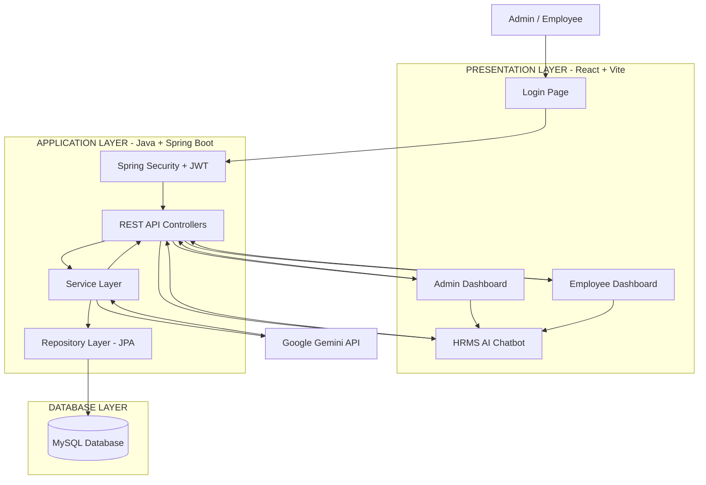
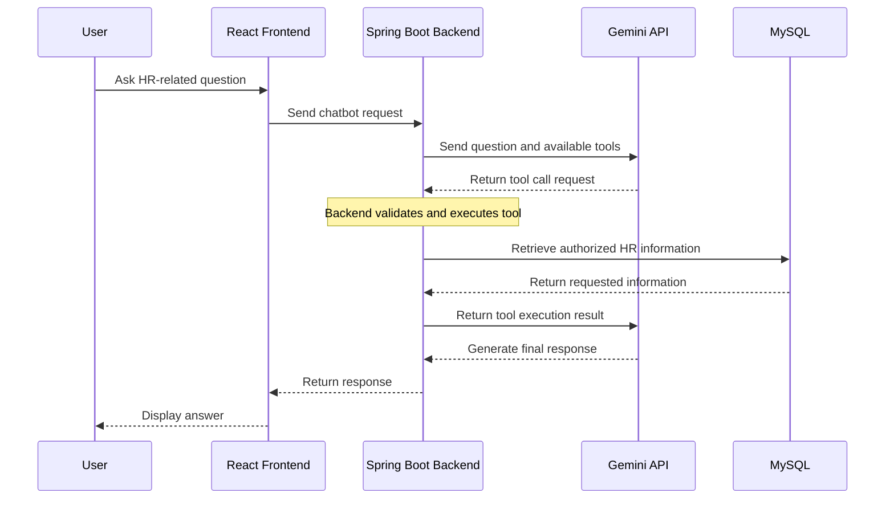
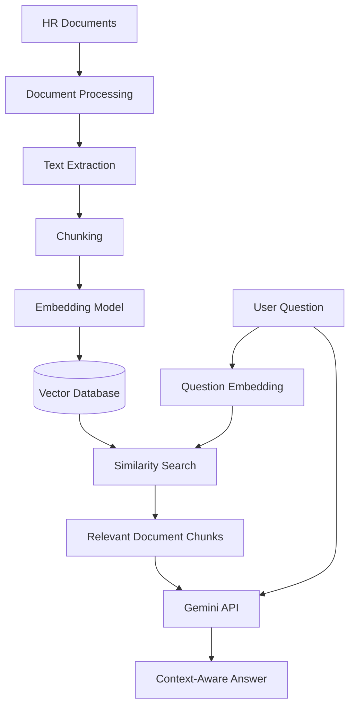

# HRMS – Human Resource Management System

A Full-Stack Employee and Human Resource Management Application with AI Chatbot Integration.

---

## 1. Project Overview

HRMS (Human Resource Management System) is a full-stack web application developed to simplify and manage organizational human resource activities.

The application provides two separate portals:

- **Admin Portal:** Allows administrators to manage employee records, attendance, leave requests and payroll.
- **Employee Portal:** Allows employees to access their personal information, attendance, leave details and payroll information.

The application also integrates Google's Gemini API to provide an AI-powered chatbot for HR-related assistance.

The system follows a frontend-backend architecture, where React communicates with Java Spring Boot REST APIs, and the backend manages business logic, authentication and database operations.

## 2. Technologies Used

| Component | Technology |
|---|---|
| Frontend | React.js |
| Programming Language | JavaScript |
| UI | HTML5, CSS3 |
| Frontend Build Tool | Vite |
| Backend | Java 21 |
| Backend Framework | Spring Boot 4.0.10 |
| Security | Spring Security |
| Authentication | JWT |
| API Communication | REST APIs |
| ORM | Spring Data JPA |
| Database | MySQL |
| AI Integration | Google Gemini API |
| Gemini SDK | google-genai 2.6.0 |
| Backend Build Tool | Maven |
| Version Control | Git and GitHub |

## 3. System Architecture Diagram

The HRMS application follows a three-layer architecture consisting of the presentation layer, application layer and database layer, with an external AI integration.

### 3.1 High-Level Architecture



### 3.2 Architecture Explanation

**1. Presentation Layer**

- Developed using React.js and JavaScript.
- Provides separate interfaces for Admin and Employees.
- Displays employee information, attendance, leave and payroll details.
- Provides the chatbot interface.

**2. Application Layer**

- Developed using Java and Spring Boot.
- Exposes REST APIs to the frontend.
- Handles authentication and authorization using Spring Security and JWT.
- Processes business logic through service classes.
- Communicates with MySQL using Spring Data JPA.

**3. Database Layer**

- MySQL stores HR-related application data.
- Spring Data JPA handles database operations.

**4. AI Integration Layer**

- Google Gemini API is integrated for AI-powered responses.
- The backend communicates with Gemini and returns generated responses to the frontend.

*Note: The diagram represents the overall application architecture. Dedicated RAG retrieval and Gemini function-calling execution are not yet verified as implemented.*

---

## 4. Complete Project Directory Structure

The repository is organized into two main modules: frontend and backend.

```text
HRMS-Employee-Management-System/
│
├── hrms-frontend/
│   │
│   ├── public/
│   │
│   ├── src/
│   │   │
│   │   ├── assets/
│   │   │
│   │   ├── components/
│   │   │   ├── HrmsChatbot.jsx
│   │   │   ├── HrmsChatbot.css
│   │   │   └── [Other reusable components]
│   │   │
│   │   ├── pages/
│   │   │   ├── Login.jsx
│   │   │   ├── AdminDashboard.jsx
│   │   │   └── EmployeeDashboard.jsx
│   │   │
│   │   ├── services/
│   │   │   └── [API communication files]
│   │   │
│   │   ├── App.jsx
│   │   ├── App.css
│   │   ├── main.jsx
│   │   └── index.css
│   │
│   ├── index.html
│   ├── package.json
│   └── vite.config.js
│
├── hrms-backend/
│   │
│   ├── src/
│   │   │
│   │   ├── main/
│   │   │   │
│   │   │   ├── java/
│   │   │   │   └── com/
│   │   │   │       └── iceipt/
│   │   │   │           └── hrms/
│   │   │   │               │
│   │   │   │               ├── config/
│   │   │   │               │   └── [Configuration classes]
│   │   │   │               │
│   │   │   │               ├── controller/
│   │   │   │               │   └── [REST API controllers]
│   │   │   │               │
│   │   │   │               ├── dto/
│   │   │   │               │   └── [Request and response DTOs]
│   │   │   │               │
│   │   │   │               ├── entity/
│   │   │   │               │   └── [Database entities]
│   │   │   │               │
│   │   │   │               ├── repository/
│   │   │   │               │   └── [JPA repositories]
│   │   │   │               │
│   │   │   │               ├── security/
│   │   │   │               │   └── [JWT and security classes]
│   │   │   │               │
│   │   │   │               ├── service/
│   │   │   │               │   └── [Business logic and AI services]
│   │   │   │               │
│   │   │   │               └── HrmsApplication.java
│   │   │   │
│   │   │   └── resources/
│   │   │       └── application.properties
│   │   │
│   │   └── test/
│   │       └── java/
│   │           └── [Backend test classes]
│   │
│   └── pom.xml
│
├── .gitignore
└── README.md
```

**Directory responsibilities:**

| Directory | Responsibility |
|---|---|
| components | Reusable React components |
| pages | Login and dashboard pages |
| services | Frontend API communication |
| config | Backend configuration |
| controller | REST API endpoints |
| dto | Data transfer objects |
| entity | Database entity classes |
| repository | Database access operations |
| security | Authentication and authorization |
| service | Application business logic |
| resources | Application configuration |
| test | Backend testing |

*The tree illustrates the logical organization of the application. Keep actual filenames and directories synchronized with the committed repository; the bracketed entries describe responsibilities rather than additional implemented files.*

---

## 5. Application Features

### 5.1 Admin Portal

- Secure admin login.
- Admin dashboard.
- Employee management.
- Employee record viewing.
- Attendance management.
- Leave management and approval.
- Payroll management and preview.
- HRMS AI chatbot.
- Admin logout.

### 5.2 Employee Portal

- Employee authentication.
- Employee dashboard.
- View personal information.
- Access attendance information.
- View leave details.
- View payroll information.
- Employee logout.

### 5.3 Authentication and Security

- Spring Security integration.
- JWT-based authentication.
- Separate Admin and Employee roles.
- Protected backend resources.
- Authenticated API access.

### 5.4 AI Chatbot

- Google Gemini API integration.
- AI-generated responses.
- HR-related question answering.
- Backend integration for AI communication.

---

## 6. AI Integration and Working

### 6.1 Google Gemini API Integration

The application uses the Google Gemini API through the Google GenAI Java SDK.

The chatbot follows this general request-response flow:

1. The user enters an HR-related question.
2. The React chatbot sends the question to the backend.
3. The backend processes the incoming request.
4. The backend communicates with the Gemini API.
5. Gemini generates an AI response.
6. The backend returns the response.
7. React displays the response in the chatbot interface.

### 6.2 Tool Calling

Tool calling allows an AI model to request the execution of predefined backend functions.

For example, an HR assistant could use tools such as:

- `getEmployeeDetails`
- `getAttendanceDetails`
- `getLeaveBalance`
- `getPayrollDetails`

**Expected tool-calling workflow:**



**Current implementation status:** The Google Gemini SDK dependency and API configuration are present. Dedicated function declarations, tool-call handling and execution of backend HR functions have not been verified in the current implementation. This workflow describes the intended capability, not a completed feature.

### 6.3 Retrieval-Augmented Generation (RAG)

Retrieval-Augmented Generation (RAG) is an approach in which an AI model retrieves relevant information from an external knowledge source before generating an answer.

For an HRMS application, RAG could retrieve information from HR policies, employee handbooks, leave policies and payroll documentation.

**Expected RAG architecture:**



**RAG workflow:**

1. Collect relevant HR documents.
2. Extract text from documents.
3. Divide text into smaller chunks.
4. Convert chunks into vector embeddings.
5. Store the embeddings in a vector database.
6. Convert the user's question into an embedding.
7. Retrieve relevant chunks using similarity search.
8. Send the retrieved information and question to Gemini.
9. Generate a context-aware response.

**Current implementation status:** A document ingestion pipeline, vector database, embedding generation and retrieval pipeline have not been verified in the current source code. RAG is therefore documented as an extension, not a completed feature.

---

## 7. Chunking and Embedding Choices

Chunking and embedding are important components of a RAG-based system.

### 7.1 Chunking

Chunking divides large documents into smaller sections so that relevant information can be retrieved efficiently.

For example, an HR policy document can be divided into separate sections covering:

- Leave policies.
- Attendance policies.
- Payroll policies.
- Employee responsibilities.

### 7.2 Embeddings

Embeddings convert text into numerical vectors that represent semantic meaning.

These vectors can be compared to identify information relevant to a user's question.

### 7.3 Configuration and Implementation Status

| Parameter | Current Status |
|---|---|
| Document processing | Not implemented / verified |
| Chunking method | Not selected |
| Chunk size | Not configured |
| Chunk overlap | Not configured |
| Embedding model | Not selected |
| Vector database | Not integrated |
| Similarity search | Not implemented / verified |
| Gemini response generation | SDK and API integration configured; full chatbot flow requires verification |

**Important:** Google Gemini text generation does not itself mean that an embedding model or vector database is being used. The above RAG parameters must be updated after implementing and testing an actual retrieval pipeline.

---

## 8. Installation and Setup

The project is designed to run locally using Java, Maven, Node.js and MySQL.

### 8.1 Prerequisites

Install the following software:

| Software | Requirement |
|---|---|
| Java | JDK 21 |
| Maven | Compatible Maven installation |
| Node.js | Compatible with the Vite project |
| npm | Included with Node.js |
| MySQL | MySQL Server |
| Git | Latest stable version |

### 8.2 Clone the Repository

```bash
git clone YOUR_GITHUB_REPOSITORY_URL
cd HRMS-Employee-Management-System
```

### 8.3 Database Configuration

1. Start your MySQL server.
2. Create the project database.
3. Open the backend `application.properties` file.
4. Configure your database connection.

Example configuration:

```properties
spring.datasource.url=jdbc:mysql://localhost:3306/hrms_db
spring.datasource.username=YOUR_DB_USERNAME
spring.datasource.password=YOUR_DB_PASSWORD

spring.jpa.hibernate.ddl-auto=update
spring.jpa.show-sql=true
```

Use the actual database name and settings required by the project.

Never commit real database passwords to GitHub.

### 8.4 Gemini API Configuration

Configure your Gemini API key through an environment variable.

PowerShell example:

```powershell
$env:GEMINI_API_KEY="YOUR_GEMINI_API_KEY"
```

Use the same environment-variable name expected by the backend configuration.

Do not expose the API key in source code or public repositories.

### 8.5 Start the Backend

Open PowerShell in the project directory:

```powershell
cd hrms-backend
mvn spring-boot:run
```

The Spring Boot application will start using the configured database connection.

### 8.6 Start the Frontend

Open another terminal:

```powershell
cd hrms-frontend
npm install
npm run dev
```

### 8.7 Access the Application

Open the local URL displayed by the Vite development server in your browser.

The backend and frontend should now be running.

### 8.8 Setup Time Target

The assignment requires the project to start on a fresh machine in under 10 minutes.

The setup procedure is designed to be short, provided Java, Maven, Node.js and MySQL are already installed and the database and API credentials are available.

**Fresh-machine execution time: Not yet independently verified.**

---

## 9. Testing and Results – 10 Test Scenarios

The following test scenarios cover authentication, dashboard functionality, employee operations, HR modules and AI integration.

| No. | Test Scenario | Expected Result | Result / Status |
|---|---|---|---|
| 1 | Admin login with valid credentials | Admin dashboard opens | Passed – dashboard tested |
| 2 | Admin dashboard navigation | Dashboard tabs open correctly | Passed – manually tested |
| 3 | Employee login with valid credentials | Employee dashboard opens | Opened during manual testing; full validation pending |
| 4 | Invalid login credentials | Access is rejected | Not verified |
| 5 | Employee record management | Employee records are displayed and managed | Partial – full CRUD testing pending |
| 6 | Attendance management | Attendance details are accessible | Not independently verified |
| 7 | Leave management | Leave details and approval operations work | Not independently verified |
| 8 | Payroll management | Payroll preview and information are accessible | Not independently verified |
| 9 | AI chatbot | Gemini generates an appropriate response | Not independently verified end-to-end |
| 10 | Logout functionality | User returns to login page | Passed – redirect issue was corrected and manually tested |

### Additional Build Verification

| Component | Verification |
|---|---|
| Backend | Maven build completed successfully |
| Frontend | Build completed successfully |
| Gemini API key | Environment configuration was successful |
| Admin dashboard | Opened successfully |
| Dashboard navigation | Manually tested |

*Test results above distinguish reported manual checks from tests that have not been independently verified. Execute all ten scenarios against the final committed version before submitting the final results.*

---

## 10. Limitations and Unfinished Work

The following items require further implementation, verification or improvement.

| Feature | Status |
|---|---|
| Core HRMS frontend | Implemented |
| Spring Boot backend | Implemented |
| MySQL integration | Implemented |
| Admin and Employee portals | Implemented |
| JWT authentication | Implemented |
| Attendance and leave modules | Implemented; complete testing pending |
| Payroll module | Implemented; complete testing pending |
| Gemini SDK integration | Dependency and API configuration present |
| Complete chatbot end-to-end validation | Pending |
| Gemini function/tool calling | Not verified / incomplete |
| RAG implementation | Not implemented / verified |
| Document chunking | Not implemented |
| Embedding generation | Not implemented |
| Vector database | Not integrated |
| Complete ten-scenario test execution | Pending |
| Fresh-machine setup under 10 minutes | Not verified |

### Future Enhancements

- Implement Gemini function calling for HR-related backend operations.
- Develop a RAG pipeline using HR documents.
- Integrate an embedding model and vector database.
- Improve chatbot responses using relevant HR knowledge.
- Complete end-to-end and security testing.
- Improve deployment and production configuration.

---

## 11. Security Considerations

- JWT-based authentication.
- Role-based access for Admin and Employee portals.
- Spring Security for protected backend resources.
- Database credentials maintained in private configuration.
- Gemini API key maintained outside the public repository.
- Sensitive employee information should only be accessible to authorized users.

---

## 12. Project Objective

The objective of this project is to develop a centralized HR management platform that simplifies employee administration, improves accessibility to HR services and introduces AI-powered assistance through Google Gemini.

The project combines frontend development, backend engineering, database management, authentication and AI integration in a single full-stack application.

---

## 13. Author

**Kavita Zore**

GitHub: https://github.com/kavitazore19

**Project Name:** HRMS – Human Resource Management System

**Project Type:** Full-Stack Web Application

**Primary Technologies:** React.js, Java, Spring Boot, MySQL and Google Gemini API.
